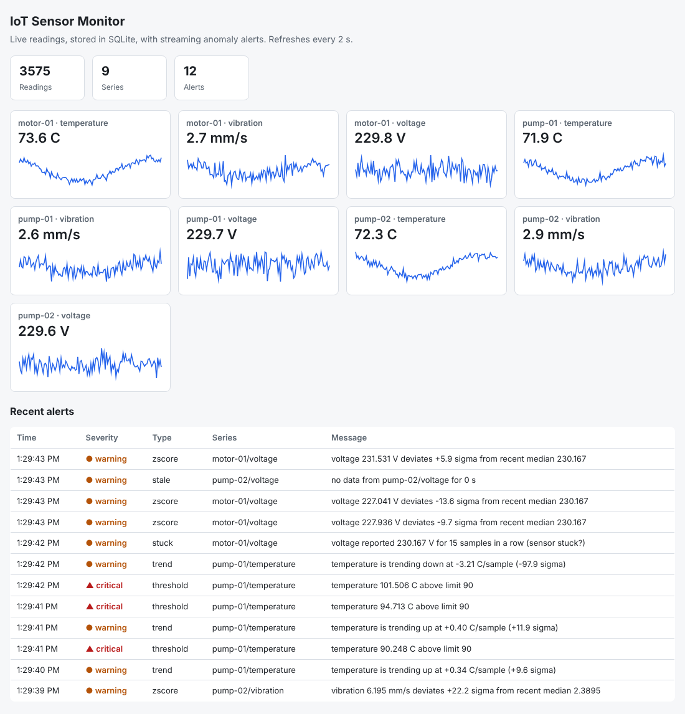

# IoT Sensor Monitor

A small end-to-end monitoring pipeline for sensor data: simulated devices publish readings, the
system validates and stores them, detects anomalies as they arrive, and shows everything on a live
dashboard. The core uses only the Python standard library; the same code can run over a real MQTT broker.



## How it works
```
 sensors (Python or C)  --JSON-->  bus (in-memory or MQTT)  -->  ingest: validate -> SQLite -> detect
                                                                          |
                                         dashboard (HTTP + JSON API)  <---+---> alerts table
```
| Part | File | What it does |
|---|---|---|
| Simulator | `iot_monitor/simulator.py` | 9 sensors (3 devices x temperature/vibration/voltage) with seasonality, noise and injected faults: spike, drift, stuck, dropout |
| C sensor | `c/sensor.c` | Embedded-style sensor node in C that prints JSON lines; `bridge` validates and publishes them |
| Validation | `iot_monitor/schema.py` | Every message is untrusted: type, range, name and topic checks before anything is stored |
| Transport | `iot_monitor/bus.py` | `MemoryBus` (no setup) and `MqttBus` (paho-mqtt) behind one interface, with MQTT topic wildcards |
| Storage | `iot_monitor/storage.py` | SQLite, parameterised queries only |
| Detection | `iot_monitor/anomaly.py` | Hard limits, robust z-score (median/MAD), slope trend test, stuck-sensor check, per-alert cooldown; `ingest.py` adds a stale-data check |
| Dashboard | `iot_monitor/dashboard.py` | Live cards, charts and alert table; JSON API; no external assets |

## Run it
```bash
python3 -m iot_monitor demo            # simulator + ingest + dashboard in one process -> http://127.0.0.1:8000
python3 -m unittest discover -v        # 36 tests, standard library only
python3 -m iot_monitor evaluate        # measure detection delay, false alarms, throughput
```

Calls with a broker (needs `pip install paho-mqtt` and an MQTT broker such as Mosquitto):
```bash
docker compose up --build              # broker + simulator + ingest + dashboard on http://localhost:8000
# or by hand:
python3 -m iot_monitor ingest --mqtt-host localhost --db iot.db
python3 -m iot_monitor simulate --mqtt-host localhost
python3 -m iot_monitor dashboard --db iot.db
```

The C sensor:
```bash
make sensor && ./build/sensor c-node-01 100 3 | python3 -m iot_monitor bridge --mqtt-host localhost
```

## Results
Measured with `python3 -m iot_monitor evaluate` (output saved in `docs/results.txt`):

| Injected fault | First alert | Detected after (steps) | Hard limit reached after (steps) |
|---|---|---|---|
| Overheating drift (pump-01 temperature) | trend | 8 | 36 |
| Single vibration shock (pump-02) | zscore | 0 | not reached |
| Frozen sensor (motor-01 voltage) | stuck | 13 | n/a |
| Lost connection (pump-02 voltage) | stale | 8 | n/a |

- Across 40 random seeds, all 160 injected faults were detected.
- The slow drift is flagged a median of 7 steps after it starts, about 29 steps before it reaches the 90 C hard limit.
- On fault-free data the detectors raised 82 false alerts in 216,000 readings (about 1 per 2,600 readings).
- Throughput: about 12,000 messages per second with the in-memory transport and SQLite on a laptop.

## Design decisions
- **Robust statistics.** The z-score uses the rolling median and MAD, so one spike does not inflate the baseline.
  A plain rolling mean/std would also absorb slow drift, so a separate slope test measures the trend against the
  sensor's own noise (estimated from first differences, which ignores seasonality).
- **Untrusted input.** Messages are validated before storage; the API validates parameters and uses parameterised SQL.
- **Transport abstraction.** Tests and the demo need no broker; the MQTT path uses the same `publish`/`subscribe` interface.
- **Reproducible simulation.** Seeds make every run, test and benchmark repeatable.

## Limitations
- All data is simulated; no physical sensors were used.
- Alerts also fire when a fault ends (for example the jump back to normal after a stuck sensor or drift).
- Thresholds are fixed per metric; a real deployment would tune them per device.
- The Mosquitto config allows anonymous access for local use only. Add authentication and TLS for anything real.
- SQLite suits a single machine; a time-series database would be the next step at larger scale.
- The test suite covers the in-memory pipeline and the C sensor. The MQTT/Docker path is a thin wrapper
  that you should smoke-test yourself (`docker compose up --build`, then open the dashboard).

## Ideas to extend
Per-device learned baselines, alert delivery (email/webhook), MQTT authentication and TLS, a Grafana dashboard
on the SQLite data, or porting the C sensor to a microcontroller SDK.
